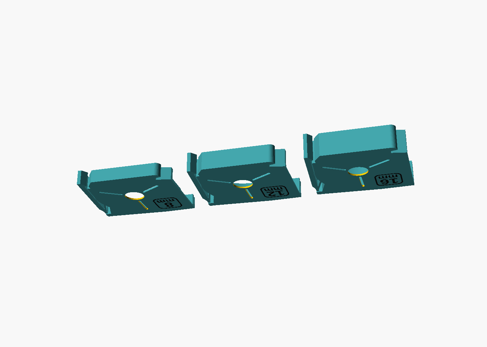
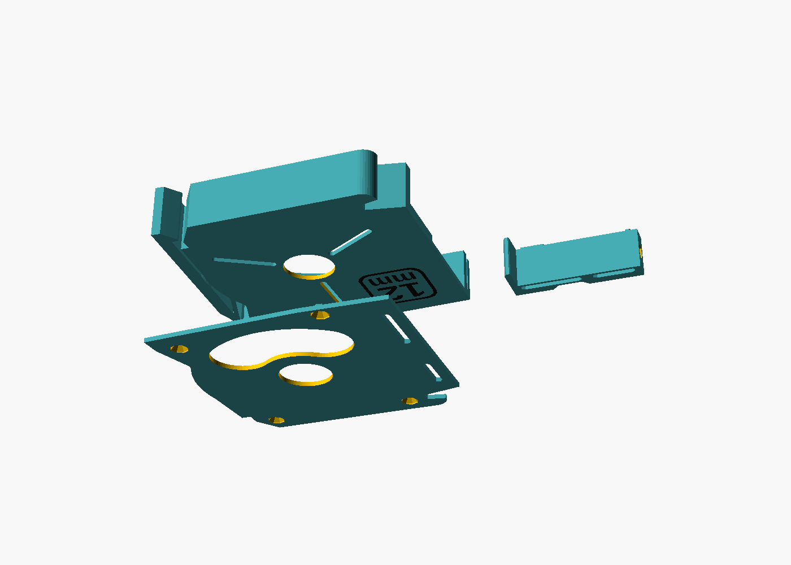
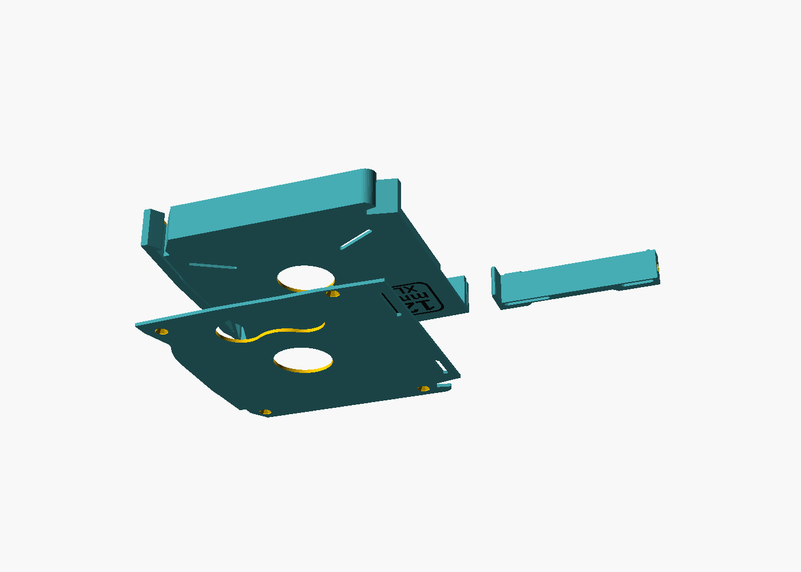
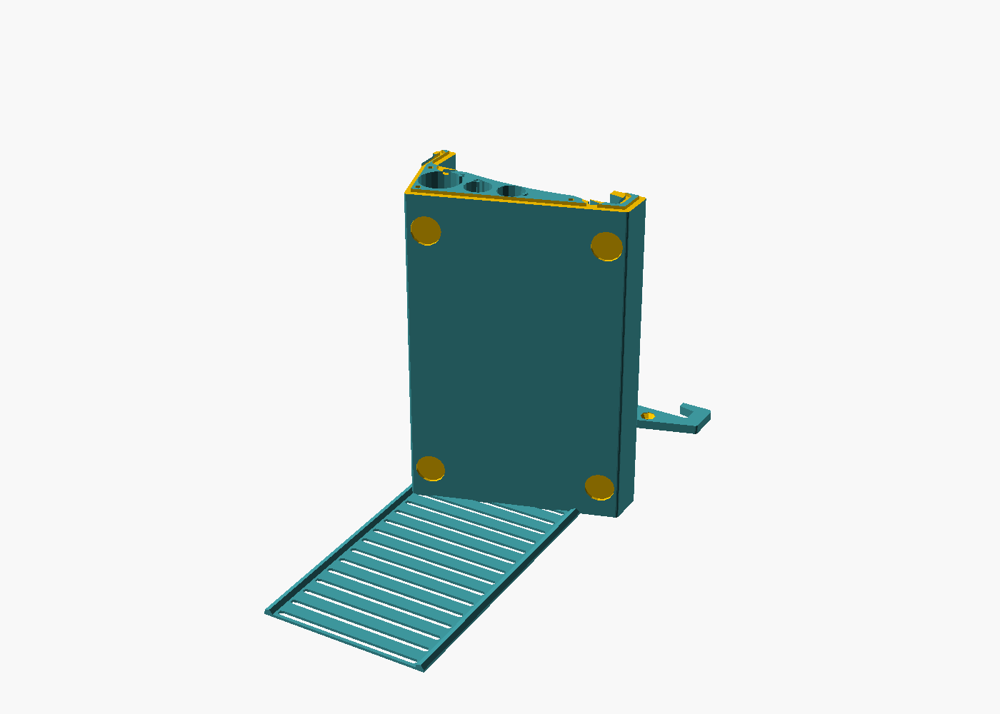
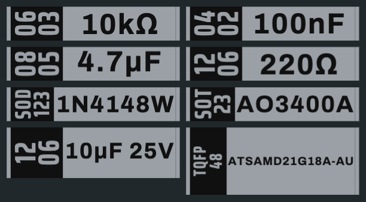
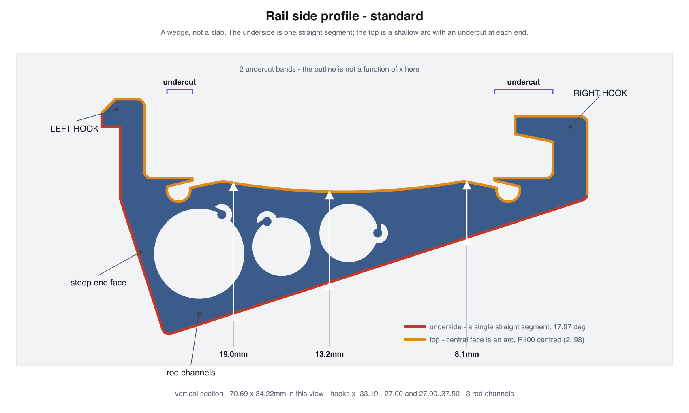

# SMD component tape magazines

Wall-mounted magazines for SMD parts on cut tape, in two capacities and three
tape widths, plus the rail they clip to.



## Credit where it is due

This is a derivative work. The geometry that matters — the magazine body, lid,
slider, rail and leaf spring — is not ours.

| | |
|---|---|
| **[@LordAsdi](https://www.printables.com/model/580643)** | The original SMD Component Tape Magazine. Every 2D profile in `scad/` is projected from their STLs, which are kept verbatim in `scad/upstream/`. Licensed **CC-BY 4.0**. |
| **T. Wirtl (tobi)** | The parametric OpenSCAD remix that turned those STLs into adjustable code. `scad/container.scad` and `scad/rail.scad` keep their original headers. Licensed **CC-BY-SA 4.0**. |
| **[Bryan Varner](https://www.printables.com/model/1350841)** | The Varnerized Edition, the version this tree started from. Licensed **CC-BY-SA 4.0**. |
| **[Robin Reiter](https://www.youtube.com/watch?v=YbU5u_0wWts)** | Not a code ancestor — the *inspiration*. His "SMD Magazines G2" video is where the anti-release lip idea comes from. |

Our additions are the anti-release lip, the two-colour badge, the XL size, the
long rail, the build tooling and the label maker.

## Licence

Two licences, because this repository holds two different kinds of thing.

| | |
|---|---|
| **[CC-BY-SA 4.0](LICENSE)** | The design. `scad/*.scad`, the imported profiles in `scad/upstream/`, the renders and this documentation. Not a free choice: two of the upstreams above are share-alike, so anything derived from them has to be too. Attribution and share-alike carry on to anything you make from it. |
| **[MIT](LICENSE-MIT)** | The software. `label-maker/index.html` and everything in `tools/`. Written here from scratch, and no use to anyone under a licence Creative Commons themselves [advise against for code](https://creativecommons.org/faq/#can-i-apply-a-creative-commons-license-to-software). |

Every file under MIT carries an `SPDX-License-Identifier: MIT` line, so there
is no guessing which side of the line it falls on. Anything without one is
CC-BY-SA 4.0.

The lip is **not** a copy of Robin's part. Our lever is a different mechanism —
a full-depth flap, not a cantilever — so ours matches the intent, not
the geometry.

## What you can print

Ready-to-print files are attached to the [latest
release](../../releases/latest) — the repository itself carries source only, so
a clone stays small and nothing here is a stale copy of something the build
produces. To make them yourself instead, run `tools/build.sh`; they land in
`print/`.

Either way they are plain **core-spec 3MF**: geometry and filament assignment,
nothing else. No slicer profile is baked in, so import one into whatever slicer
you use and apply your own settings. They come in a 0.4 and a 0.6 nozzle
variant; see below for why that matters and which to take.

```
print/0.4mm-nozzle/   6 magazine plates, badge recess 0.2mm
print/0.6mm-nozzle/   6 magazine plates, badge recess 0.3mm
print/rails/          4 rail plates, either nozzle
```

| plate | pocket | outside | holds |
|---|---|---|---|
| `magazine-standard-8mm` | r29.5 | 75.0 × 68.5 | ~800 of 0603 |
| `magazine-standard-12mm` | r29.5 | 75.0 × 68.5 | |
| `magazine-standard-16mm` | r29.5 | 75.0 × 68.5 | |
| `magazine-xl-8mm` | r42 | 100.0 × 93.5 | ~1600 of 0603 |
| `magazine-xl-12mm` | r42 | 100.0 × 93.5 | |
| `magazine-xl-16mm` | r42 | 100.0 × 93.5 | |
| `rail-100mm` | | 70.7 × 34.2 × 102 | standard magazines |
| `rail-300mm` | | 70.7 × 34.2 × 302 | standard magazines |
| `rail-xl-100mm` | | 95.7 × 38.3 × 102 | XL magazines |
| `rail-xl-300mm` | | 95.7 × 38.3 × 302 | XL magazines |

### Which nozzle

**Take the magazines from the folder matching your nozzle.** The badge recess is
cut exactly one first layer deep, so its depth is a property of the nozzle:
0.2mm at 0.4, 0.3mm at 0.6. Print a 0.3mm recess with a 0.2mm first layer and
the badge sits proud by a layer; the other way round it never fills. Set the
slicer's first layer to match the folder and everything else is yours to choose.

**The rails are nozzle-independent** — one set works with either. They carry no
badge, and the only other nozzle-ish constant, `line_width = 1.3mm` for the cap
groove, is two 0.65 perimeters on a 0.6 and three 0.43 lines on a 0.4. Narrowing
it for the 0.4 would gain nothing and would stop 0.4-nozzle caps fitting
0.6-nozzle rails.

Each magazine plate carries three objects and four parts: the badge is a
second *part* of the body object, not a separate object, so Arrange cannot
slide it out of its recess. The badge is assigned to **filament 2** in the
file, so it arrives on the second colour without you setting anything, and
only the size marking changes colour — grey body, black badge, no purge line
around the part. On a single extruder, delete the badge
part and swap filament at layers 2 and 3 instead; that also leaves a thin accent
line round the whole part, which the separate badge avoids.

The badge is grouped with its body as 3MF **components**, so it is one build
item — a slicer's Arrange moves the pair together and cannot slide the badge out
of its recess.





### Rail capacity

The rail prints standing, so its length is limited by build height, not bed
area. An H2D takes 325mm.

Pitch is the magazine's full outside thickness,
`2*side_wall_thickness + width + tape_spacing` = `width + 3.3` — the lid seats
inside the pocket, so nothing nests.

| tape | pitch | per 100mm rail | per 300mm rail |
|---|---|---|---|
| 8mm | 11.3mm | 8 | 26 |
| 12mm | 15.3mm | 6 | 19 |
| 16mm | 19.3mm | 5 | 15 |

A 300mm rail prints 302mm tall on a 70.7 × 34.2mm footprint — slender enough to
want a brim. Mounting feet are spaced by `rail_foot_pitch` (95mm), so the long
rail gets four instead of two.

**The leaf spring ships in segments.** Past about 100mm it is a 0.8mm ribbon
that curls off the bed and is awkward to thread into the channel, so the plate
divides the rail length into equal pieces no longer than `spring_max_len`
(100mm) and lays them side by side: a 300mm rail gets **3 × 100mm**. They butt
end to end in the channel and are retained by the rail base and the cap, exactly
as one long leaf would be. Each segment keeps 7mm of solid land at both ends —
the previous single 300mm leaf had a lightening slot landing exactly on its free
edge, shaving the last millimetre across 46 of its 52.8mm width.



## Labelling what you put in them

`label-maker/index.html` answers the two questions that come up every time a
reel arrives: which magazine to print for it, and what goes on the card.



Open the file — that is the whole install. No build step, no server, no
network, no account. It is also the GitHub Pages site for this
repository, published from `label-maker/` by the workflow in `.github/`, so the
live tool and the source are one file with no second copy to drift. Served from there it works out which repository it came
from and turns its own recommendation into a download link straight to the
release asset, so a scan ends at the magazine rather than at a filename. Opened
as a local file there is nothing to derive from, so it prints the `print/` path
instead — set `PROJECT_URL` near the top of the file to link a local copy at
the same place. Scan a reel with a USB barcode scanner (they type like a
keyboard) or paste a code; DigiKey and Mouser Data Matrix, LCSC/JLCPCB QR, and
bare part numbers all work. Nothing about the part is looked up online, because
the barcode already carries the manufacturer part number and the quantity.

**Which magazine.** Tape width comes from the package, following EIA-481, read
out of the part number where that number carries it — which covers most
passives and almost no ICs. When it cannot tell, it says so rather than
defaulting to 8 mm and sending you off to print the wrong case. Standard
against XL is the reel quantity against
`π(r² − r_hub²) / (carrier × pitch)`, using the pocket radii from the table
above; it reproduces this README's own published figures of ~800 and ~1600 of
0603 as 801 and 1678. Standard has to be a clear win — inside three quarters of
one — because the sensitive term in that formula is carrier thickness, which is
a dropdown rather than a measurement.

**The label.** Matches `label(width)` in `container.scad` exactly: 41.4 ×
*width* + 0.2 × 3.3 mm, the same slot as the blank cards. The package runs up
the end of the card reversed out of a band of the second filament, turned 90°;
the value gets the rest. Output is a plain core-spec 3MF with two objects and
two base materials, the same shape `make_3mf.py` writes, so it imports beside
the magazine parts, with the lettering already on filament 2. Labels queue up as you scan,
and **Save plate** writes them all as one 3MF laid out for your bed.

Release assets are a flat list, so the nozzle folder that separates the plates
in `print/` becomes part of the filename. `./tools/build.sh --release` does that
renaming into `release/`, and the page builds its download links by the same
rule, so the two cannot drift apart.

Geometry is built in the page: text rasterised at 40 px/mm, contours traced off
the bitmap, simplified, holes bridged and ear-clipped, then extruded to a
closed shell. Three separate things can be too fine for a nozzle — the strokes,
the card left standing between two glyphs, and the counter inside a `0` — and
the page measures all three and reports the worst before you print. Part-number
decoding has a table of known-good cases baked in; open with `?selftest` to run
them.

## Publishing

`publish/` holds what the model listings need. `instructions.md` is the build
document that ships with the download — a different job from this README, which
is for someone deciding whether the repository is worth their time rather than
someone who already has the files and wants to assemble them.

```bash
./tools/build.sh --release         # print/, stl/, and release/
./tools/check_3mf.py               # verify every plate before it ships
python3 tools/make_pdf.py          # publish/SMD-magazines-instructions.pdf
python3 tools/make_upload.py       # upload/, the zips for the model sites
python3 tools/make_listing.py      # publish/*.txt, paste-ready descriptions
```

In that order: the check exits non-zero on a real fault, so run it before
packaging and a bad plate cannot reach a zip.

`check_3mf.py` is worth running before any upload. A slicer does not refuse a
bad mesh, it repairs it and carries on, so a file can be wrong for a long time
without anything saying so.

`make_upload.py` packs what the model sites take: one zip of the sixteen
plates, one of every part as a separate STL, and the PDF left loose so it can
go up as its own file. Both sites take the same set. The STLs are rewritten as
binary on the way in - OpenSCAD emits ASCII, which is four times the size for
identical geometry, so 110MB becomes 26MB and the zip 6MB. Verified by
round-tripping all sixty back and comparing against the originals: worst
coordinate difference 0.015 microns, which is float32 quantisation and nothing
else. The 3MFs are copied byte for byte, because they are what people print.

`printables.md` and `makerworld.md` are the listing descriptions, each with the
licence and remix fields the upload form needs. Paste the `.txt` beside them,
not the markdown: `make_listing.py` produces those, because both sites use
rich-text editors rather than markdown fields, and the `.md` pastes in badly
twice over - the markup arrives as literal punctuation, and the 80-column
wrapping arrives as real line breaks, so each paragraph lands as eight separate
lines that the editor's own wrapping can no longer reflow. Both carry the full credit chain in the body text:
Printables links only one parent, and MakerWorld's remix credit only points at
models hosted there, so neither platform can express a three-deep chain that
lives on Printables. The text has to.

## Regenerating the figures

```bash
python3 tools/draw_rail_profile.py    # images/rail-side-profile.{svg,png}
```

That script is self-contained — it drives OpenSCAD itself and derives every
dimension label from the measured section, so the drawing cannot disagree with
the part. The renders in `images/` come from `scad/render.scad`, one
scene per pass:

```bash
OPENSCAD=/Applications/OpenSCAD.app/Contents/MacOS/OpenSCAD
$OPENSCAD --render -D 'SCENE="widths"' -D SPAN=75 --imgsize=1400,1000 \
  --projection=p --colorscheme=Tomorrow --viewall --autocenter \
  --camera=0,0,0,115,0,15,0 -o images/widths-standard.png scad/render.scad
```

## Layout

```
scad/            the design, OpenSCAD sources               CC-BY-SA 4.0
  upstream/      LordAsdi's STLs, verbatim, for the profiles  CC-BY 4.0
tools/           build tooling                                     MIT
label-maker/     index.html, the reel intake bench                 MIT
images/          what the README shows, all generated
publish/         listing text and the instructions PDF source
print/ stl/ release/    build outputs, not in git - see Releases
```

The folders follow the licence split, so which licence covers a file is a
matter of where it sits rather than something to take on trust.

## Building

Needs **OpenSCAD and python3**. No slicer — building a plate never launches one.

```bash
./tools/build.sh
```

That produces all sixteen plates - six magazines per nozzle plus four rails. `./tools/build.sh magazine-xl-12mm` does one; an
unknown name lists the valid ones rather than silently building nothing. The
OpenSCAD binary is `$OPENSCAD` if you set it.

## What we changed

**Anti-release lip.** The lever's top tab is lowered by `shoulder_drop` and the
body's top edge carries out over it, leaving a notch underneath. A finger
landing on top of the magazine rests on the lip instead of the lever; to release
you reach in under it. Settled on `shoulder_drop = 6.0` — a 4.8mm lip, the
deepest cut that still clears the moulded thumb pad at y +22.5..+27.5 where the
lever is actually pressed. Chosen by printing four variants side by side.

**Two-colour badge.** The size marking is recessed by exactly one first layer,
and `badge_insert()` fills that recess as a separate part.

**XL.** `grow_x`/`grow_y` split the profile at x=0 and y=0 and push the halves
apart, sweeping the seam to fill. Nothing is rescaled — the lever, foot, hooks,
lid interface, slider and all hardware keep their exact size and only move. At
12.5 the pocket goes r29.5 → r42.

`body_scale` also exists and scales everything uniformly. No entry point sets it, so it is permanently 1.0 — it is a manual knob for opening the file directly, **not** how the XL is built, and **not** used by the regression harness despite what this file used to claim. Scaling drags the tape exit and slider engagement with it.

## Why the seam runs through the centre

The splits have to be at x=0 and y=0. A boundary point only moves when
`|x| > a` or `|y| > b`, so splits at `±a, ±b` leave a stationary band unless
`a² + b² ≤ R²`. The split positions that miss every feature are `|x| ≥ 25` and
`|y| ≥ 20`, and 25² + 20² = 1025 against R² = 870 — that band never moves and
the pocket stays r29.5, gaining nothing. Splitting through the centre is not a
shortcut; it is the only position that grows a circular pocket.

So features sitting on the split lines are **filled before the seam and cut back
afterwards** (`2d_right_clean`, `2d_lid_clean`) rather than being smeared and
patched. The round window, level slot and lid access opening are drawn by us at
both sizes from one code path, with no size-dependent branch.

## The rail

The rail is a **wedge**. Its underside is a single flat plane carrying the
mounting feet; the top is a shallow arc, **R100 centred (2, 98)**, and there is
an **undercut band at each end** (x −23.70..−20.01 and 24.00..32.49) where a
vertical line meets the outline four or six times, so the outline is not a
function of x there.



**Longer** is `rail_len`. **Wider** is `rail_grow_x`, which moves both hooks
25mm apart to match the XL foot.

Widening forces the mounting angle to change, and this is not a choice. The XL
foot moves both engagement points 12.5mm apart in x while keeping their 3.83mm
height difference, so the hooks must separate **horizontally**. A plane through
both then has the same rise over a longer run:

| | rise | run | angle |
|---|---|---|---|
| standard | 19.498 | 60.121 | **17.97°** |
| XL | 19.498 | 85.121 | **12.90°** |

Hold 17.97° and the plane shears 4.87mm off the moved right hook. Everything
keyed to the mounting angle — the feet and the screw bosses — reads
`rail_angle()`, so it follows automatically.

Three things had to follow the plane and did not, at first:

- a **rod channel broke through the mounting face** — the shallower plane thins
  the wedge right of the split, so an 8.5mm channel in a 9.1mm section cut clean
  through. That channel now stays in the seam band, which keeps its depth.
- the **bottom 2mm slab** still used the un-widened body, leaving the XL rail
  standing **2.74mm off the wall**. Invisible in a mid-height section.
- the **foot pads** were pinned to the old plane: one was entirely absent, a
  sealed void inside the part. `rail_foot_xy()` now re-reads them off the
  current plane.

Measured after: underside within **0.00003mm** of one flat plane at both widths
and at z=1, z=10 and z=50; rod channels 135.22 / 56.35 / 56.35 mm² at both;
feet 1.000 / 1.005mm deep. The standard rail is **byte-identical** to before at
68.2143 cm³ and 11928 triangles.

## Checking a grown size against the standard

`tools/compare_sizes.py` slices both sizes at eight heights and asks, for a grid of
sample points: is the material at (x, y) in the standard also material at
`gp(x, y)` in the grown part? Away from the seam that must hold everywhere.

```bash
cd src && ./compare_sizes.py --grow 12.5 --set window_d=22 --set 'badge_note="XL"'
```

Every seam bug so far has been the same shape — a constant that did not follow
the growth — and every other check (manifold, connected, lid clearance) looks
only *inside* the grown part and cannot see any of them. Run this after any
change to the growth.

> **Its last clean verdict predates a parser fix and should not be trusted.**
> The coordinate pattern had no exponent clause, so OpenSCAD's `7.47293e-06` —
> the form it uses for coordinates landing on zero — parsed as `7.47293`, a
> 7.5mm error, precisely on the x=0 / y=0 split lines this script exists to
> check. Fixed; **re-run before relying on the XL.**

## Audit findings, fixed

- **Slider detent track.** Length was fixed at 30mm while growth moved the two
  guide slots 25mm further apart, so the upper slot lost *all* engagement
  (36% → 0%). The track end now comes from `sp()` like the start.
- **Label slot depth.** The seam replaces part of the 2.75° top edge with a
  horizontal plateau while the slot keeps its tilt, cutting pocket depth to
  3.03mm against a 3.3mm card. The slot now drops 0.6mm on grown bodies.

Checked and fine: all four screw bosses, the badge, the coil-spring pocket, and
all four slider pin/slot pairs.

## Open questions

- **XL lever feel.** Measured: the lever is a **full-depth flap hinged on the
  1.25mm bottom skin**, not a flap on a 2.25mm web as this file used to claim.
  Material in the lever window is a constant 329.50mm² from z=2 to z=10; only
  the z=0.5 slice differs, at 350.25mm². That 20.75mm² skin bridge is the whole
  hinge. The XL's slot is 83mm against the standard's 58mm, so at equal skin it
  is markedly softer for the same push. `lever_web_scale` exists and is
  monotonic, but it drives the slider-channel end wall, not the lever — real
  stiffening needs a local rib over that bridge, gated to grown bodies so the
  standard part does not move.
- **XL tape path.** Tape exit and slider engagement keep true size but now sit
  25mm further apart. Untested on real tape.
- **Dual rail.** Not built, and blocked on the rewrite above. The plan is the
  stock profile for the inner hooks and spring channel plus the same hooks moved
  out to the XL foot, sharing one seat height so a single leaf spring serves
  both. It also needs the XL floor deepened 3mm → about 13mm, or the standard
  hooks punch up into the XL's tape space — see
  `images/why-xl-foot-must-deepen.png`.
